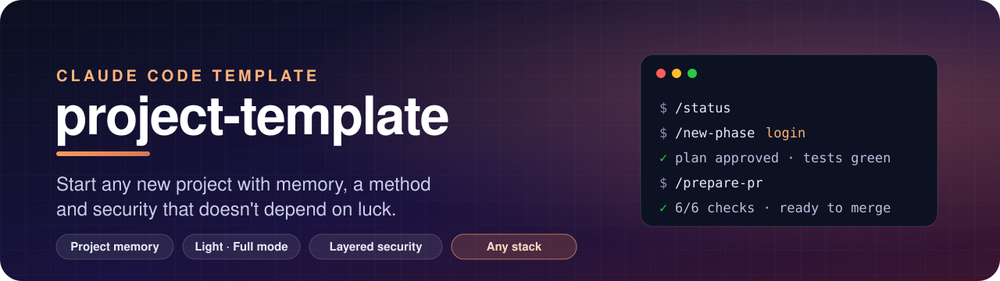
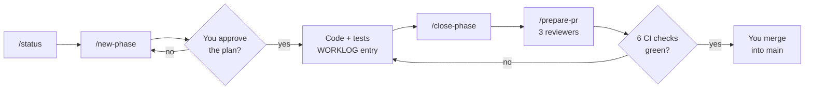
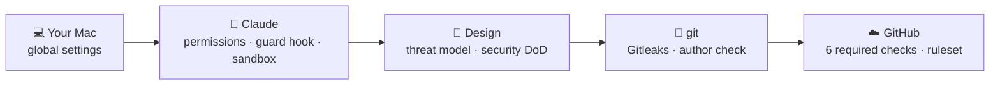

<p align="center">
  
</p>

<p align="center">
  <a href="https://github.com/serbenda/project-template/actions/workflows/ci.yml"></a>
  
  
  
  <br>
  
  
  
  
  
  <br>
  
  
</p>

<p align="center">
  <b>Start any new project with Claude Code, with a memory it can read, a method it has to follow<br>and security that doesn't depend on anyone remembering.</b>
</p>

<p align="center">
  <a href="#-quick-start">Quick start</a> ·
  <a href="#-how-it-works">How it works</a> ·
  <a href="docs/WORKFLOWS.md">All workflows</a> ·
  <a href="#%EF%B8%8F-security">Security</a> ·
  <a href="#-whats-inside">What's inside</a> ·
  <a href="README.es.md">🇪🇸 Guía en castellano</a>
</p>

---

## ✨ Why

AI agents forget everything between sessions, expand the scope on their own and will happily commit a secret or an injection if nothing stops them. This template fixes the three problems at once:

| | Problem | What the template does |
|---|---|---|
| 🧠 | **No memory** | `docs/` is the project's memory: vision, state, plan, decisions and a worklog with the *why* of every change. Claude reads it at the start of every session. |
| 🧭 | **No method** | Work goes in small phases. The plan is approved before any code, the scope is fixed, and closing a phase checks its criteria and the Definition of Done. |
| 🛡️ | **No brakes** | Six layers, from your Mac to GitHub: permissions, a guard hook, a sandbox, a threat model, git hooks and six required CI checks. |

## 🚀 Quick start

```bash
# 1. GitHub → "Use this template" → create the repo, then:
git clone https://github.com/serbenda/<your-project>.git && cd <your-project>

# 2. Configure it (protects main, git hooks, empty history).
#    Options: MODE=light (experiments) · SIGNED_COMMITS=1 · AGENT_BOT=<login> (agent account)
#    Re-running it is safe; pass the same options again.
./scripts/setup-repo.sh

# 3. Commit what it changed (it touches guardrail files, so the owner's switch):
git add -A && GUARDRAILS_OWNER_CHANGE=1 git commit -m "chore: set up from the template"
```

Then open Claude Code in the folder:

```text
/status                    where are we and what's next
/decision project stack    pick the language and tools (ADR, challenged)
/challenge <anything>      independent second opinion + comparison
/new-phase <what>          plan → your approval → code
/close-phase               criteria + Definition of Done + state updated
/prepare-pr                3 reviewers + PR development → main (you merge)
```

Once per Mac, follow [What you have to do](docs/SECURITY_GUIDE.md#2-what-you-have-to-do-once): 2FA, `brew install gitleaks` and the global Claude settings.

## 🔄 How it works



**Two modes**, chosen at setup and switchable later:

| | 🪶 Light | 🏗️ Full |
|---|---|---|
| For | Experiments, prototypes, small tools | Anything that lasts or that others use |
| Planning | Plan in chat, recorded in `STATE.md` | A phase file per block of work, inside stages |
| Docs kept | VISION, STATE, WORKLOG, SETUP, THREAT_MODEL (setup removes ROADMAP, RISKS and phases) | All of `docs/` |
| Branches, hooks, CI, sandbox | Same | Same |

Claude proposes switching to full as soon as someone else uses the project, it is deployed, it handles personal data or money, it lasts more than a month or someone else contributes.

👉 **Every flow as a diagram** (new project, sessions, phases, decisions, PRs, blocks, releases, syncing old projects): [docs/WORKFLOWS.md](docs/WORKFLOWS.md)

## 🛡️ Security



| Layer | What it stops |
|---|---|
| **Global settings** | Reading `.env`, SSH/AWS keys, the gh token, browser data or the keychain; editing its own settings, your shell or git config; bypass-permissions mode |
| **Guard hook** (fails closed, runs from the last commit, tripwire) | Any push other than `git push origin development` or a work branch, rewriting history, `rm -rf`, `curl \| sh`, AI signatures, touching its own guardrails, changing the git identity |
| **Sandbox** (OS-enforced) | Shell commands, Docker included, write only inside the project and never to the guardrails (`.claude/`, `.githooks/`, `.github/`, `.devcontainer/`, enforcement scripts); they reach only GitHub and package registries |
| **Threat model + DoD** | Sensitive code without a threat model; missing authorisation, weak password hashing, no rate limits, open CORS, missing security headers, untested backups |
| **Git hooks** | Any commit touching the guardrails (however it was staged), a secret in a commit (before it exists; no Gitleaks, no commit), a commit with another author, any push to `main` or force push (however it was typed) |
| **CI on every PR** | `Secrets` · `Authorship` · `Hook` · `Records` · `SAST` (Semgrep, any language) · `Dependencies` (OSV-Scanner, any lockfile) |
| **Ruleset** | Merging into `main` without a PR and six green checks; with `AGENT_BOT`, without your approval as code owner |
| **Agent account + dev container** (optional, recommended in full mode) | The agent acting as you on GitHub (it gets write access only: it can't approve, change settings, force-push or delete `main` or `development`, or touch tags; a PR you approved it can merge); the agent seeing anything on your Mac beyond the project |

Every action is pinned to a commit SHA and every scanner image to a digest. Details: [docs/SECURITY_GUIDE.md](docs/SECURITY_GUIDE.md).

## 📦 What's inside

```text
.
├── docs/
│   ├── VISION.md            what it is, for whom, and what NOT to do
│   ├── STATE.md             living state (≤150 lines), read first every session
│   ├── WORKLOG.md           the why of every change
│   ├── ROADMAP.md           stages S0… with exit criteria
│   ├── phases/              one file per phase (P01…)
│   ├── decisions/           numbered ADRs
│   ├── THREAT_MODEL.md      what we protect, from whom, and the controls
│   ├── ARCHITECTURE.md · RISKS.md · SETUP.md · DEFINITION_OF_DONE.md · SECURITY_GUIDE.md
│   ├── WORKFLOWS.md         every flow, as diagrams
│   └── templates/           the README new projects start with
├── .claude/
│   ├── settings.json        permissions + sandbox
│   ├── hooks/guard.sh       the guard
│   ├── commands/            /status /new-phase /close-phase /decision /challenge /prepare-pr
│   ├── agents/              security · DoD · architecture reviewers · challenger
│   └── skills/              6 skills, pinned (UPSTREAM.md)
├── .githooks/               pre-commit (guardrails, Gitleaks) · commit-msg (author, AI signatures) · pre-push (no main, no force)
├── .github/                 CI (6 jobs) · Dependabot with cooldown · PR template · CODEOWNERS · scanner pins
├── .devcontainer/           optional container: Claude sees only the project
├── scripts/                 setup-repo · sync-from-template · check-records · their tests
├── AGENTS.md                rules for any AI agent
├── CLAUDE.md                Claude Code specifics, imports AGENTS.md
└── README.es.md             full guide in Spanish
```

**Skills:** `record-changes` (own: the worklog), `security-audit` (Cloudflare), `repo-security-posture` (superagent-ai), `mcp-builder`, `webapp-testing` and `frontend-design` (Anthropic).

## 🔁 Keeping projects up to date

Projects created from an older version get the improvements with one command, run from this repo:

```bash
scripts/sync-from-template.sh ../my-project          # report only
scripts/sync-from-template.sh ../my-project --apply  # replace the template-owned files
```

It never touches `main`, copies only committed template files, never writes through a symlink, never overwrites what each project adapts (permissions, CI jobs, rules) and records the version in `.claude/TEMPLATE_VERSION`.

## 🧪 How it was tested

- CI green on every push; guard hook (1364 cases), git hooks (160), records check (46) and `setup-repo`/`sync` (69, with a fake `gh`) run on Linux, and all but the git hooks also on macOS bash 3.2.
- End to end on GitHub in a throwaway repo: direct push to `main` rejected, a PR without a worklog entry blocked, a PR with an AI signature blocked, all checks green with a proper PR.
- Real Claude Code sessions in both modes: `/status`, `/new-phase` (it stopped a feature that contradicted the vision), `/close-phase` (it stopped on a missing owner approval), `/prepare-pr` with the three reviewers. The security reviewer found a guard regression that was fixed before release.
- Sandbox: package registries reachable, other sites and writes outside the project blocked.
- Semgrep and OSV-Scanner run on the template itself: both clean.

The full history, with the reasons, is in [docs/WORKLOG.md](docs/WORKLOG.md).

## 📄 License

No license: © Sergio Santiago Bendaña Quesada. All rights reserved. The code may be viewed, but not copied, modified or redistributed without the author's written permission.
