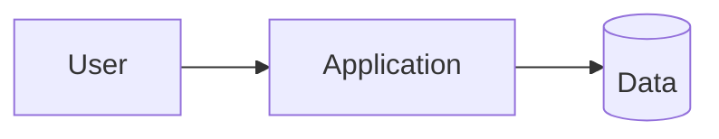

# Architecture

> How it is built, from a bird's-eye view. Update it when a piece or a flow changes, not on every commit.
> The reasons behind each choice are in [decisions/](decisions/).

## Pieces

| Piece | What it does | Technology | Folder |
|---|---|---|---|
| <!-- e.g.: API --> | | <!-- per the stack decision --> | |

## Data flow
<!-- Where the data comes from, where it goes through and where it ends up. Mark which data is untrusted external input. -->

## External sources
| Source | What it provides | License | If it fails… |
|---|---|---|---|
| | | | |

## Code conventions
<!-- What you can't infer by reading the code: where each thing goes, naming, mandatory patterns. -->
