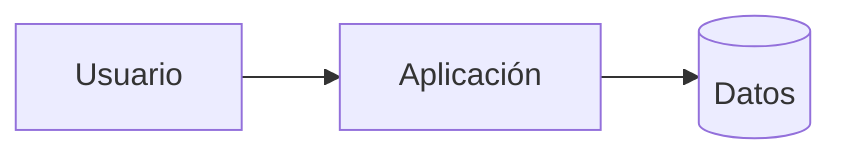

# Arquitectura

> Cómo está hecho, a vista de pájaro. Se actualiza cuando cambia una pieza o un flujo, no cada commit.
> Las razones de cada elección están en [decisiones/](decisiones/).

## Piezas

| Pieza | Qué hace | Tecnología | Carpeta |
|---|---|---|---|
| <!-- p. ej.: API --> | | <!-- según la decisión de stack --> | |

## Flujo de datos
<!-- De dónde vienen los datos, por dónde pasan y dónde acaban. Marca qué es dato externo no confiable. -->

## Fuentes externas
| Fuente | Qué aporta | Licencia | Si falla… |
|---|---|---|---|
| | | | |

## Convenciones del código
<!-- Lo que no se deduce leyendo el código: dónde va cada cosa, nombres, patrones obligatorios. -->
